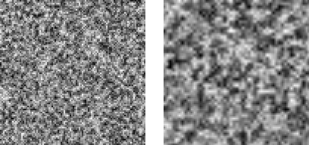

МИНИСТЕРСТВО НАУКИ И ВЫСШЕГО ОБРАЗОВАНИЯ РОССИЙСКОЙ ФЕДЕРАЦИИ

ФЕДЕРАЛЬНОЕ ГОСУДАРСТВЕННОЕ БЮДЖЕТНОЕ ОБРАЗОВАТЕЛЬНОЕ УЧРЕЖДЕНИЕ ВЫСШЕГО ОБРАЗОВАНИЯ

«ДОНСКОЙ ГОСУДАРСТВЕННЫЙ ТЕХНИЧЕСКИЙ УНИВЕРСИТЕТ» (ДГТУ)

# ОТЧЁТ

по лабораторной работе № 1
«Подготовка рабочей среды и паспорт воспроизводимого AI-эксперимента»

по дисциплине «Искусственный интеллект в креативных технологиях»

Вариант 27
Зернистая плёнка (постобработка) × шаг решётки ×2

Выполнил: ______________________________
Группа: _________________________________
Проверил: _______________________________

Локальные расчёты: 20.10.2026
Часть Б: заполняется после самостоятельного выполнения

2026

---

# 1. Цель, постановка задачи, критерии успеха и гипотеза

## 1.1. Цель и постановка

Подготовить изолированную рабочую среду, зафиксировать условия эксперимента в паспорте и проверить воспроизводимость по контрольным суммам полных выходных данных. Объект — учебный генератор процедурных текстур v1.0, модель-заменитель генеративной системы. Качество реальной нейросетевой модели в работе не оценивается.

Вариант 27 соответствует контексту 5 и фактору 3: N=(5−1)·6+3. Текстура имитирует плёночное зерно: важны мелкий масштаб и равномерность по кадру. Исследуется удвоение шага решётки при прочих равных.

| Параметр | База | Фактор |
| --- | --- | --- |
| Размер, пикселей | 96×96 | 96×96 |
| cell, пикселей | 2 | 4 |
| Число октав | 2 | 2 |
| persistence | 0,70 | 0,70 |
| Квантование | 8 бит | 8 бит |
| Интерполяция | smooth | smooth |
| Seed / n | 101–105 / 5 | 101–105 / 5 |

## 1.2. Критерии и исходная гипотеза

Воспроизводимость: EQ_1_2=true, EQ_1_4=true, EQ_1_3=false, EQ_2_4=true. Для четырёх метрик используется заранее заданное учебное правило |Δ|>2·s_base, где Δ=m̄_factor−m̄_base, s — выборочное стандартное отклонение (делитель n−1). Это не формальный статистический тест и не утверждение об уровне статистической значимости.

Гипотеза: укрупнение зерна снижает граничную энергию, ожидается превышение порога. Контраст и энтропия предположительно снижаются; превышение порога по ним заранее не утверждалось. Средняя яркость остаётся примерно прежней, ниже порога. Возможен рост межзапускового разброса средней яркости; для остальных метрик направление изменения разброса заранее не задаётся.

Протокол записан 2026-10-20T19:58:05.322349+03:00; локальный коммит e73126a выполнен до новых расчётов. До очистки старые материалы были доступны: это новое выполнение с предварительной фиксацией протокола для новых запусков, а не слепая первоначальная регистрация. Порог и гипотеза после расчётов не изменялись.

# 2. Данные, происхождение, лицензии и ограничения

Внешний набор данных отсутствует. Изображения синтетические, порождаются локальным random.Random(seed). Скрипты lab01_generator.py и lab01_experiment.py предоставлены в материалах курса и сохранены без изменения. Происхождение кода зафиксировано; отдельная лицензия на его распространение в предоставленных материалах не указана. Отсутствие внешнего датасета не означает произвольного разрешения на распространение кода.

Персональные и конфиденциальные входные материалы не используются. Сторонние пакеты не установлены: requirements.txt намеренно пуст. Источники для работы — методичка lab01, скрипты курса; приложенный PDF другого студента использован только как образец формы.

lab01_generator.py SHA-256:
8f07d340a5a765a8e44f1fec407489cf00114ba54216aa7539c4e7116680e152

lab01_experiment.py SHA-256:
69257206dab50ef35de448b45764daad0d4f60dbc98febd8953c6faee28e06b5

# 3. Среда, версии и параметры

| Параметр | Фактическое значение |
| --- | --- |
| ОС | Windows-10-10.0.19045-SP0 |
| Архитектура | AMD64 |
| Интерпретатор | CPython 3.10.6 |
| zlib: сборка / выполнение | 1.2.12 / 1.2.12 |
| Генератор | 1.0 |
| Пакеты | Только стандартная библиотека |
| Основной запуск, Москва | 2026-10-20T19:58:49+03:00 |
| Среда | .venv в корне репозитория |

Структура: src/ — два исходных скрипта и средства воспроизведения; configs/ — протокол; artifacts/fresh_run/ — новые результаты; reports/ — журнал, полный паспорт, иллюстрации и отчёт. Среда .venv исключена из Git; каждый эксперимент имеет отдельную папку. Подробные сведения — reports/environment.json.

# 4. Ход работы

## 4.1. Подготовка и фиксация протокола

Удалены прежние результаты, журналы и промежуточные файлы внутри lab01; исходные материалы сохранены. Создана новая среда Python; выполнены pip freeze и проверка импорта. Протокол и контрольные суммы записаны в registration.json, затем создан коммит до новых запусков. Ниже команды приводятся относительно корня репозитория.

python -m venv .venv
.\.venv\Scripts\python.exe -m pip freeze
.\.venv\Scripts\python.exe -c "import sys; sys.path.insert(0,'lab01/src'); import lab01_generator"

## 4.2. Намеренная ошибка и её исправление

Генератор дважды запущен без --seed с параметрами базы варианта 27. Он сообщил об автоматическом выборе seed по системному времени; отпечатки оказались различны. Затем два запуска с --seed 101 дали одинаковые массивы. Для каждого запуска использована отдельная папка, поэтому повторные результаты не перезаписывались.

| Запуск | Фактический seed | SHA-256 пикселей, начало |
| --- | --- | --- |
| noseed_1 | 1492550676 | b185a87351bc30e8 |
| noseed_2 | 1606524776 | be5cffc183e4376c |
| seed_1 | 101 | fbbd63d2201d1cb6 |
| seed_2 | 101 | fbbd63d2201d1cb6 |

Симптом — различие полных данных при одной команде. Причина — seed берётся из времени, если аргумент пропущен. Исправление — явный --seed и локальный генератор. Точные команды, предупреждения и результаты сохранены в artifacts/fresh_run/*.log и error_demo/.

## 4.3. Основной и дополнительные запуски

.\.venv\Scripts\python.exe lab01\src\lab01_experiment.py --variant 27 --seed 101 --n 5 --out lab01\artifacts\fresh_run\v27_n5

Весь набор опытов воспроизводится командой ниже, при этом выходной каталог должен быть новым. Она также выполняет n=20, n=50, демонстрационный вариант и независимый пересчёт сводки по сохранённым данным каждого seed.

.\.venv\Scripts\python.exe lab01\src\run_lab01.py --out lab01\artifacts\repeat01

Точные аргументы, рабочий каталог и время каждой дочерней команды записаны в artifacts/fresh_run/commands.json. Скрипты преподавателя не изменялись; дополнительный анализ вынесен в run_lab01.py.

# 5. Результаты

## 5.1. Протокол воспроизводимости

| Запуск | Seed | SHA-256 пикселей, начало | SHA-256 PNG, начало |
| --- | --- | --- | --- |
| 1 | 101 | fbbd63d2201d1cb6 | f44c8c078ed2c70b |
| 2 | 101 | fbbd63d2201d1cb6 | f44c8c078ed2c70b |
| 3 | 1101 | e10ab97f3373b013 | 032465639d6b03bf |
| 4 | 101 | fbbd63d2201d1cb6 | f44c8c078ed2c70b |

EQ_1_2 = true
EQ_1_4 = true
EQ_1_3 = false
EQ_2_4 = true

Запуски 1, 2 и 4 при seed 101 имеют одинаковые полные массивы; запуск при seed 1101 отличается. В этой среде совпали также PNG повторных запусков. Полные 64-символьные SHA-256 хранятся в results.json и паспорте; в таблице показаны начала только для удобства чтения. Основной критерий — отпечаток пикселей, поскольку байты PNG могут зависеть от zlib.

## 5.2. Метрики основной серии n=5

Для каждой серии сообщаются среднее и выборочное s. Контраст внутри отдельного изображения вычисляется с делителем N по пикселям; это другая величина, чем выборочное s по пяти seed с делителем n−1.

| Метрика | m̄ базы | s базы | m̄ фактора | s фактора |
| --- | --- | --- | --- | --- |
| Средняя яркость | 0,500770 | 0,003845 | 0,504145 | 0,009568 |
| Контраст | 0,173459 | 0,000738 | 0,155880 | 0,002825 |
| Граничная энергия | 0,159482 | 0,001412 | 0,072729 | 0,000648 |
| Энтропия, бит | 7,483036 | 0,005091 | 7,331467 | 0,024096 |

| Метрика | Δ | ∣Δ∣/s_base | Решение при n=5 |
| --- | --- | --- | --- |
| Средняя яркость | 0,003375 | 0,88 | Не обнаружено |
| Контраст | -0,017579 | 23,80 | Обнаружено |
| Граничная энергия | -0,086753 | 61,45 | Обнаружено |
| Энтропия, бит | -0,151569 | 29,77 | Обнаружено |

Изменение средней яркости не обнаружено: отношение равно 0,88. Для контраста, граничной энергии и энтропии отношение превышает 2; все три метрики снизились. Наиболее выражено снижение граничной энергии: 54,4% относительно базы.

## 5.3. Сопоставление с исходной гипотезой

Предсказанное снижение граничной энергии с превышением порога подтвердилось. Направления изменения контраста и энтропии также совпали с ожиданием; обнаружение их изменений является результатом опыта и не выдаётся за заранее обещанный исход. Средняя яркость не превысила порог, как ожидалось.

## 5.4. Сравнение изображений и равномерности зерна

Рисунок 1 — Слева база cell=2, справа фактор cell=4; seed 101. Оба исходных изображения 96×96, увеличены в 3 раза без интерполяции.

Разброс средней яркости между seed вырос с 0,003845 до 0,009568 (в 2,49 раза). Однако разброс граничной энергии уменьшился; нельзя утверждать, что фактор увеличил разброс всех метрик.

Для проверки равномерности внутри кадра каждый кадр разбит на 4×4 участка 24×24 пикселя. Для каждого seed вычислено выборочное s средних яркостей 16 участков; затем усреднено по seed. Нормированные значения: база 0,013676, фактор 0,029038. Это описательная дополнительная метрика без отдельного порога существенности.

Укрупнение зерна сопровождается более выраженными неоднородностями средней яркости по участкам и большим разбросом общей яркости между seed. Для задачи с мелким равномерным зерном база предпочтительнее по измеренным признакам. Оценка художественного качества и восприятия плёнки требует отдельной проверки; пространственная равномерность не выводится только из межзапускового s.

## 5.5. Проверка при n=20 и n=50

| Метрика | ∣Δ∣/s, n=5 | n=20 | n=50 |
| --- | --- | --- | --- |
| Средняя яркость | 0,88 | 0,34 | 0,31 |
| Контраст | 23,80 | 18,90 | 15,70 |
| Граничная энергия | 61,45 | 79,01 | 73,51 |
| Энтропия, бит | 29,77 | 19,88 | 16,73 |

Во всех трёх сериях состав обнаруженных изменений одинаков: контраст, граничная энергия и энтропия; для средней яркости порог не превышен. Серии вложены (seed 101…105, 101…120, 101…150), поэтому это проверка устойчивости при расширении выборки, а не три независимых подтверждения.

Дополнительная оценка неопределённости использует общие seed как пары: d_i=m_factor,i−m_base,i, SE=s(d)/√n. Она учитывает связь базы и фактора и не заменяет учебное правило.

| Метрика | Δ при n=5 | Парная SE, n=5 | Парная SE, n=50 |
| --- | --- | --- | --- |
| Средняя яркость | 0,003375 | 0,003655 | 0,000824 |
| Контраст | -0,017579 | 0,001465 | 0,000381 |
| Граничная энергия | -0,086753 | 0,000466 | 0,000223 |
| Энтропия, бит | -0,151569 | 0,012459 | 0,003398 |

Для выводов с заданным уровнем значимости потребовались бы отдельный статистический план, проверка предпосылок и учёт сравнения нескольких метрик. Само значение SE формального доказательства эффекта не даёт.

## 5.6. Воспроизведение демонстрационного варианта

Демонстрационный вариант 1 выполнен при n=5. Начала SHA-256 пикселей совпали с методичкой: 93fae5913d797284 (seed 101) и 79aa3ff4187bbfe8 (seed 1101); четыре равенства выполнены. Все опубликованные в методичке средние базы, s базы и средние фактора совпали до четырёх знаков после запятой.

| Параметр | Методичка | Текущая среда |
| --- | --- | --- |
| Python | 3.13.7 | 3.10.6 |
| zlib | 1.3.1 | 1.2.12 |
| ОС | Windows 10 | Windows-10-10.0.19045-SP0 |

В методичке не приведён численный отпечаток PNG демонстрации, поэтому его межмашинное совпадение не заявляется. Проверено совпадение PNG повторных запусков внутри текущей среды. Совпадение опубликованных префиксов SHA-256 не выдаётся за сравнение отсутствующих полных эталонных хешей.

# 6. Часть Б. Рабочая область Engee

По решению пользователя в текущем выполнении оформлена только локальная часть. Часть Б выполняется пользователем самостоятельно; результаты входа, версии Engee, выполнения Julia и очистки рабочей области не заявляются. Отдельный файл reports/engee_checklist.md содержит порядок действий и перечень доказательств для дополнения этого раздела.

| Что добавить после выполнения | Фактический результат |
| --- | --- |
| Дата, версии кабинета и среды | ____________________ |
| VERSION и versioninfo() | ____________________ |
| Переменная seed=101, очистка, перезапуск | ____________________ |
| Файл .ngscript, паспорт и снимки | ____________________ |

# 7. Анализ ошибок, угроз валидности и ограничений

| Угроза | Мера и оставшееся ограничение |
| --- | --- |
| Не задан seed | Ошибка воспроизведена; использован явный seed и локальный random.Random. |
| Сравнение только средних | Воспроизводимость проверена по SHA-256 полных массивов. |
| Подгонка гипотезы | Новый протокол закоммичен до новых запусков; доступ к старым материалам честно отмечен. |
| Неверный делитель s | По seed используется n−1; сводка проверена по значениям отдельных запусков. |
| Малая выборка | Основной вывод при n=5; дополнительно n=20,50. Серии вложены. |
| Смена среды и кода | Записаны Python, zlib, ОС и SHA-256 исходных скриптов. |
| Ограниченность метрик | Они описывают яркость и структуру, не заменяют зрительскую оценку. |
| Неправомерное обобщение | Проверены один контекст, один фактор и одна реализация генератора; правило 2s — учебное. |

# 8. Вывод по цели

Цель локальной части достигнута: создана изолированная среда без сторонних пакетов, условия записаны в паспорт, воспроизводимость подтверждена четырьмя сравнениями полных выходных данных. При n=5 удвоение cell с 2 до 4 существенно по учебному правилу снижает контраст, граничную энергию и энтропию; изменение средней яркости не обнаружено. Снижение граничной энергии с превышением порога соответствует исходной гипотезе.

Межзапусковый разброс средней яркости вырос, а неоднородность средних яркостей участков увеличилась в описательной проверке. Для мелкого равномерного зерна предпочтительнее базовый шаг. Расширенные серии сохранили решения по четырём метрикам. Выводы не доказывают отсутствие слабого эффекта по яркости, художественное превосходство изображения или переносимость результата на реальные нейросети. Часть Б остаётся для самостоятельного дополнения.

# 9. Артефакты, паспорт и ссылки

Репозиторий: https://github.com/BookWormDevid/Creative_AI_things, каталог lab01/. Коммит предварительного протокола: e73126aca3128e50746329a8fb4db4f81ddeaba3. Новые коммиты созданы локально; публикация на GitHub в эту работу не входит.

| Путь относительно lab01 | Назначение |
| --- | --- |
| reports/report.docx, report.pdf, report.md | Редактируемый отчёт, PDF и исходник |
| reports/passport.md | Полный паспорт |
| reports/journal.md, registration.json | Порядок выполнения и регистрация |
| configs/protocol.json | Параметры и гипотеза |
| artifacts/fresh_run/v27_n5/ | Основной результат и данные каждого seed |
| artifacts/fresh_run/v27_n20/, v27_n50/ | Расширенные серии |
| artifacts/fresh_run/demo_v01/, error_demo/ | Демонстрация и намеренная ошибка |
| artifacts/fresh_run/commands.json, *.log | Точные команды, время, вывод |
| reports/engee_checklist.md | Чек-лист самостоятельной части Б |
| reports/validation.json, manifest.json | Проверки и контрольные суммы файлов |
| dist/lab01_variant27_local.zip | Архив локальной части без окружения и Git |

# Приложение А. Ответы на контрольные вопросы

## 1. Почему одного запуска недостаточно?

Один seed не показывает разброс. Нужны число и список seed, среднее и выборочное s, фиксированные параметры и критерий. Здесь используются n=5 и дополнительные n=20,50.

## 2. Среднее и выборочное s для 0,71; 0,74; 0,69; 0,73; 0,70

Среднее 0,714; сумма квадратов отклонений 0,001720; s=√(0,001720/4)=0,020736; 2s=0,041473. Для среднего второй серии 0,770: Δ=0,056>2s — изменение обнаружено по учебному правилу. Нужны оговорки о n=5, неопределённости s и отсутствии формального уровня значимости.

## 3. Почему сравнивается полный массив?

Среднее теряет информацию: массивы (0,255) и (127,128) имеют среднее 127,5, но разные пиксели. SHA-256 вычисляется по всем байтам массива и позволяет практически надёжно проверить их совпадение.

## 4. Почему могут различаться PNG?

PNG содержит сжатые данные; разные версии zlib могут выдавать разные байты при тех же пикселях. В паспорт записываются версия zlib и отдельно SHA-256 пикселей и PNG. Главная проверка — массив.

## 5. Что означает s=0?

Все значения метрики в серии совпали. Проверяют изменение seed, число запусков, отпечатки и агрегацию. Разные изображения могут иметь одну метрику, поэтому s=0 не всегда ошибка. При n=1 выборочное s не определено, а не равно нулю.

## 6. Как найти причину невоспроизводимости?

Сравнить полные хеши, прочитать предупреждения, проверить фактические seed, версии и параметры. В намеренном опыте причина найдена в выборе seed по времени; явный --seed 101 восстановил совпадение.

## 7. Почему локальный random.Random(seed)?

Экземпляр изолирует состояние от чужих вызовов глобального random. Если несколько потоков делят один генератор, порядок получения чисел может различаться. Локальные генераторы и явно определённый порядок работы уменьшают скрытые зависимости.

## 8. Какие поля обязательны в паспорте?

Цель и критерий; происхождение и ограничения данных; модель и версия кода; параметры и seed; среда; точная процедура; результаты; ограничения и вывод. Потеря seed или версии кода особенно затрудняет повтор; для real-world модели нужны также неизменяемая ревизия весов и устройство.

## 9. Зачем точные версии зависимостей?

Диапазон версий допускает обновление среды без изменения файла требований. Точные версии фиксируют установленные пакеты. Здесь файл пуст, поскольку пакеты не используются, но версию самого Python всё равно нужно записать отдельно.

## 10. Что добавить для модели «текст → изображение»?

Идентификатор модели и полную ревизию весов, точные prompt и negative prompt, seed и устройство генератора, размер, число шагов, guidance scale, scheduler и его настройки, device, dtype, версии библиотек и драйверов, число потоков и настройки детерминизма, состав конвейера. Это план будущего паспорта, а не утверждение о запуске такой модели в ЛР 1.
